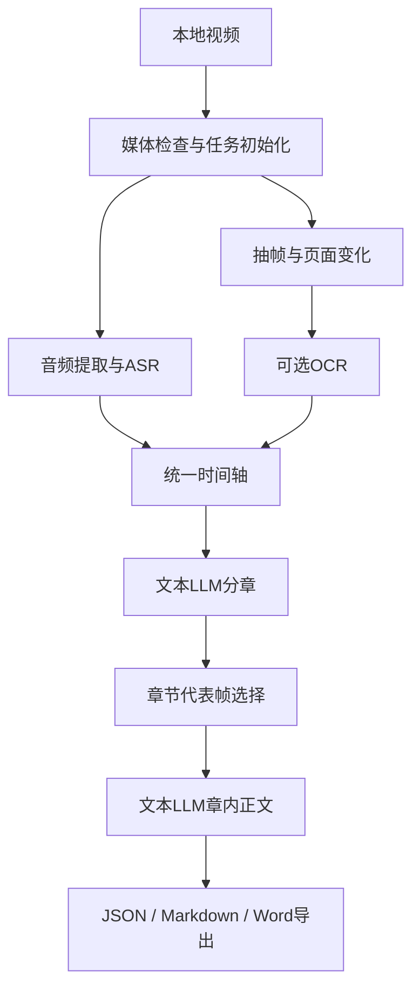

# 架构说明

## 当前处理链

OCR和画面事件主要用于时间关联、选图和模板说明。当前正文主要来自ASR，尚无VLM直接理解图片。本机Web工作区位于上述导出链周围，读取已有结果并保存独立编辑版本；它不修改M1、M2机器正式组及其`current.json`。

## 代码职责

| 入口/模块 | 职责 |
|---|---|
| `cli.py`、`m2_pipeline.py` | 命令参数及全链路编排 |
| `video_probe.py`、`task_workspace.py` | 视频检查、任务创建和源身份 |
| `audio_extract.py`、`asr_transcribe.py`、`asr_timeline.py` | 音频、带时间戳转写和文本时间轴 |
| `frame_sampler.py`、`page_change_detector.py`、`ocr_extractor.py` | 候选帧、页面变化和OCR |
| `unified_timeline.py`、`timeline_builder_v2.py` | Timeline 2.0及来源对齐 |
| `boundary_planner_v2.py` | ChapterPlan 2.0分章 |
| `chapter_frames.py` | 章节配图及确定性说明 |
| `document_composer_v2.py` | StructuredDocumentContent 3.0正文生成与发布 |
| `document_exporter_v2.py` | 自包含三格式导出包 |
| `model_roles.py`、`llm_adapter.py` | 模型配置、角色校验与网络传输 |
| `boundary_evaluation.py` | 内部章节边界评价工具 |
| `web_server.py`、`web_service.py` | 本机Web API、任务运行管理、预览编辑与独立导出 |

模型配置位于`config/model-roles.json`，目前分章与正文使用百炼的文本LLM角色。配置文件登记连接和参数，密钥由本地环境提供。测试注入脚本transport实现零真实请求。

## 产物与兼容

每个任务保存在`outputs/<task_id>/`，M2产物位于其`m2/`子目录。各阶段使用不可变结果组、文件哈希manifest及指向当前组的`current.json`。缓存绑定来源身份与相应配置，失败保留审计记录。

正文有两种生成路径：历史三调用方式，以及`--bounded-content`逐章每最多6个单元分批的方式。有界路径最多12次供应商请求，每批最多2次尝试，成功批次可复用。

coverage 2.0允许不同段落合理复用同一来源单元，检查来源、章内归属、覆盖及单调顺序。single/batch提示词为2.1。旧组按保存的coverage/prompt版本复验，原始响应重放能够复现对应结果。

编辑内容作为独立版本保存，引用原机器结果，不写回机器正式组。Web编辑服务保存在`<task>/edits/<edit-id>/`，机器正文仍由原`content/current.json`指向；编辑版导出写入`<task>/web-exports/<edit-id>/`，不会切换机器导出的`current.json`。

模块名和注释保留了旧M1/M2及阶段号，当前工作安排见[项目总览](PROJECT.md)。常用数据结构、读取接口和测试入口见[开发指南](DEVELOPMENT.md)。
